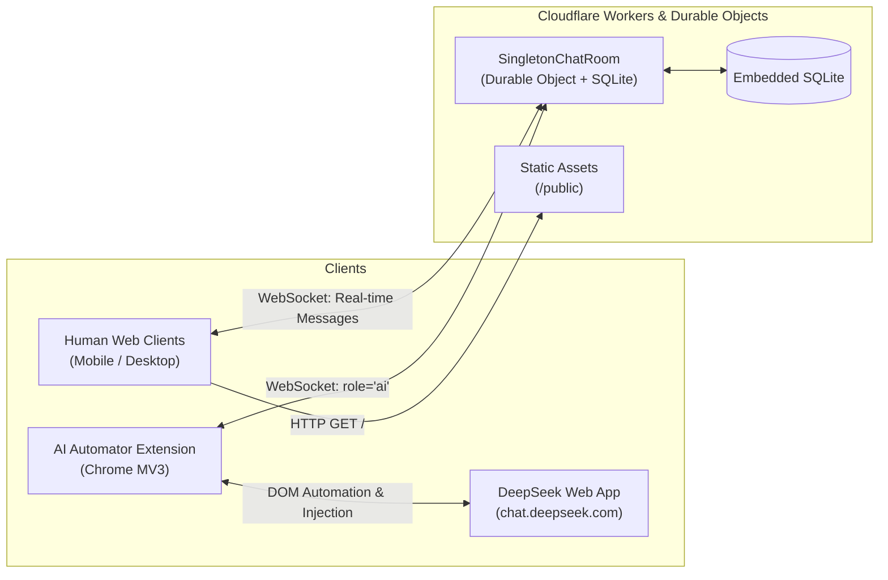

# 🌐 Uni-Chat

> Real-time singleton group chat powered by **Cloudflare Workers**, **Durable Objects (SQLite)**, and a **Headless Browser AI Automator** for DeepSeek and web-based LLMs.

[](https://workers.cloudflare.com/)
[-orange)](https://developers.cloudflare.com/durable-objects/)
[](https://developer.chrome.com/docs/extensions/mv3/)
[](https://opensource.org/licenses/MIT)

---

## 📖 Overview

Uni-Chat is a high-performance, edge-native group chat application that bridges human participants with web-based AI assistants (such as [DeepSeek](https://chat.deepseek.com)) without requiring paid API tokens.

### Key Highlights
- ⚡ **Cloudflare Workers & Durable Objects**: Global singleton room running with embedded SQLite for transactional message persistence and sub-millisecond WebSocket fanout.
- 🤖 **Headless AI Extension Bridge**: Chrome Extension (Manifest V3) that connects as an official `role: "ai"` participant, routing conversation backlogs directly into web interfaces with image attachment and multi-turn context.
- 🎯 **Strict Tag & Offline Catch-Up Modes**: AI participants can be configured for batch participation or strict tag-only mode (`@deepseek`). Mentions sent while the AI is offline are tracked on the server and delivered immediately upon reconnection.
- 📱 **Mobile & Desktop First**: Swipe-to-reply touch gestures, double-tap actions, desktop hover replies, mention autocompletion (`@tag`), image uploads, and rich Markdown/code formatting.

---

## 🏛️ System Architecture



### 1. Backend (`src/index.js`)
* **Singleton Durable Object**: All chat traffic routes to a single durable room instance (`GLOBAL_SINGLETON_ROOM`).
* **Sequential Monotonic Sequencing**: Every message is assigned a monotonically increasing sequence number (`#seq`).
* **Epoch-Based Clear Chat**: Admins can wipe messages and reset sequences while preserving user authentication and active socket connections.
* **Offline Mentions Table**: Automatically logs `@mentions` targeted at offline users or AI bots and dispatches them upon handshake.

### 2. Frontend (`public/`)
* Native JavaScript single-page application without bulky frontend dependencies.
* Full-width gesture interaction (swipe right to reply, double-click/double-tap for message details).
* Auto-scrolling viewport engine that handles mobile virtual keyboards smoothly.

### 3. AI Automator Bridge (`extension/`)
* **Adapter Pattern**: Modular AI target integration (`extension/adapters/deepseek.js`). Ready to extend to ChatGPT, Claude, or local web UIs.
* **S-Expression Protocol**: Prompts are formatted sequentially, enabling the AI to cite specific messages (`(:reply-to <seq> :body "...")`).
* **Self-Response Attribution**: Past AI responses in the transcript are substituted with `[#seq was your own previous response]` to minimize context tokens and prevent hallucinations.

---

## 🚀 Getting Started

### Prerequisites
* [Node.js](https://nodejs.org/) (v18 or higher)
* [Cloudflare CLI (Wrangler)](https://developers.cloudflare.com/workers/wrangler/) (`npm install -g wrangler` or `npx wrangler`)
* A Cloudflare account

---

### Step 1: Clone & Install

```bash
git clone https://github.com/h-990/uni-chat.git
cd uni-chat
npm install
```

---

### Step 2: Configure Environment & Secrets

Run the built-in setup helper to generate cryptographic secrets:

```bash
node setup.js <your_admin_password>
```

This will automatically create a `.dev.vars` file for local development and print the secret injection commands for Cloudflare Workers:

```bash
echo "<ADMIN_PASSWORD_HASH>" | npx wrangler secret put ADMIN_PASSWORD_HASH
echo "<HMAC_SECRET>" | npx wrangler secret put HMAC_SECRET
```

---

### Step 3: Run Locally

```bash
npm run dev
```

Visit `http://localhost:8787` in your browser.

---

### Step 4: Deploy to Cloudflare Workers

```bash
npm run deploy
```

Your live chat will be accessible at:
`https://<worker-name>.<your-subdomain>.workers.dev`

---

## 🔌 AI Chrome Extension Setup

1. Open Google Chrome and navigate to `chrome://extensions/`.
2. Enable **Developer mode** (toggle in the top-right corner).
3. Click **Load unpacked** and select the [`extension/`](./extension) folder from this repository.
4. Log into [chat.deepseek.com](https://chat.deepseek.com) in one browser tab.
5. In Uni-Chat, open the **Admin Panel** (`ADMIN` account) -> **AI Accounts** -> Create username `deepseek` with a password/key.
6. Click the **Uni-Chat Automator** extension icon, enter your Server URL, AI username, and password, and click **Connect as AI**.
7. The extension will join the room as an official AI participant and begin routing messages!

### Routing Modes
| Mode | Description |
| :--- | :--- |
| **Normal Batch Mode** | Messages accumulate up to the configured batch threshold (e.g. 20 messages) or trigger immediately when `@deepseek` is tagged. |
| **Strict Tag Mode** | Only messages where `@deepseek` is explicitly tagged (or direct replies to DeepSeek) are routed. All other messages are ignored. |

---

## 📂 Project Structure

```text
uni-chat/
├── src/
│   └── index.js              # Cloudflare Worker + SingletonChatRoom Durable Object
├── public/
│   ├── index.html            # Single-page chat interface
│   ├── style.css             # Responsive theme, layouts, bubble alignments & gestures
│   └── app.js                # WebSocket client, gestures, mention auto-complete, rendering
├── extension/
│   ├── manifest.json         # Chrome Extension Manifest V3
│   ├── background.js         # Service worker, connection manager, prompt dispatcher
│   ├── content.js            # Injects & scrapes web AI responses
│   ├── popup.html            # Extension status & configuration panel
│   ├── popup.js              # Settings controller
│   ├── sexpr.js              # S-Expression prompt builder & response parser
│   └── adapters/
│       ├── index.js          # Adapter registry
│       └── deepseek.js       # DeepSeek Web DOM adapter
├── architecure.md            # Detailed master engineering specification
├── setup.js                  # Secret generation script
├── wrangler.toml             # Cloudflare Workers & Durable Objects configuration
└── package.json
```

---

## 🔒 Security & Privacy

* **Passwords**: Passwords are salted and hashed with SHA-256 before storing or transmission.
* **Tokens**: Session tokens are cryptographically signed using HMAC-SHA256.
* **Separation of Secrets**: Keys and passwords are stored in Cloudflare Secrets and omitted from version control via `.gitignore`.
* **Zero Tracking**: No external analytics or tracking scripts are bundled.

---

## 📄 License

This project is licensed under the [MIT License](LICENSE).
